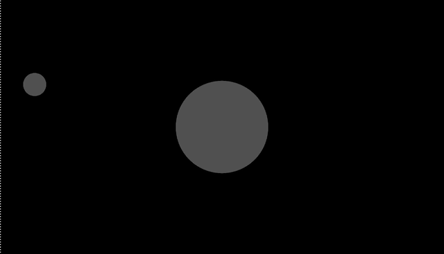
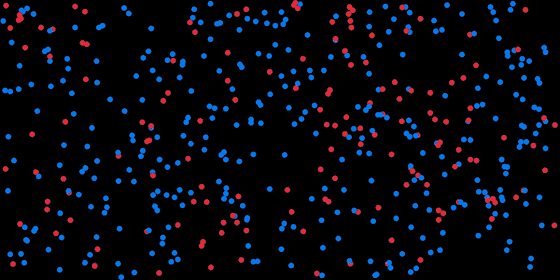

<h1 align="center">Hi, I'm Zakary 👋</h1>

  Self-taught programmer and student at <b>42 Lausanne</b> 
  <b>C/C++ · physics simulations · embedded systems</b>

  
  
  

🔎 Looking for junior or internship roles in software, embedded or simulation — Lausanne area or remote.

---

## 🧪 What I build

<table>
  <tr>
    <td width="50%" valign="top">
      
      <h3><a href="https://github.com/MountainEnjoyer/DoublePendulum">DoublePendulum</a></h3>
      Chaotic double pendulum driven by its equations of motion, rendered in real time with Raylib. 
      <code>C</code> <code>Raylib</code> <code>numerical integration</code>
    </td>
    <td width="50%" valign="top">
      
      <h3><a href="https://github.com/MountainEnjoyer/GravitationalForces">GravitationalForces</a></h3>
      A stream of objects curving around two celestial bodies under gravity (shown at 3× speed), configurable from a launch script. 
      <code>C</code> <code>Raylib</code> <code>Bash</code>
    </td>
  </tr>
  <tr>
    <td width="50%" valign="top">
      
      <h3><a href="https://github.com/MountainEnjoyer/Electrostatism">Electrostatism</a></h3>
      500 positive and negative charges interacting through Coulomb's law. 
      <code>C</code> <code>Raylib</code> <code>N-body</code>
    </td>
    <td width="50%" valign="top">
      <h3><a href="https://github.com/MountainEnjoyer/SoundSystem">🎛️ SoundSystem</a></h3>
      Modular synthesizer built on Arduino: hardware and firmware. 
      <code>C++</code> <code>Arduino</code> <code>electronics</code>
        
      <h3><a href="https://github.com/MountainEnjoyer/ShellScripts">🐚 ShellScripts</a></h3>
      Scripts to learn and automate everyday tasks. 
      <code>Bash</code> <code>Linux</code>
    </td>
  </tr>
</table>

## 🛠️ Tech

  <b>Main</b> 
    
  <b>Also</b> 
  

## 🌱 Currently

- Learning radio and electronics
- Looking for open-source projects to contribute to (C, embedded, tooling)
